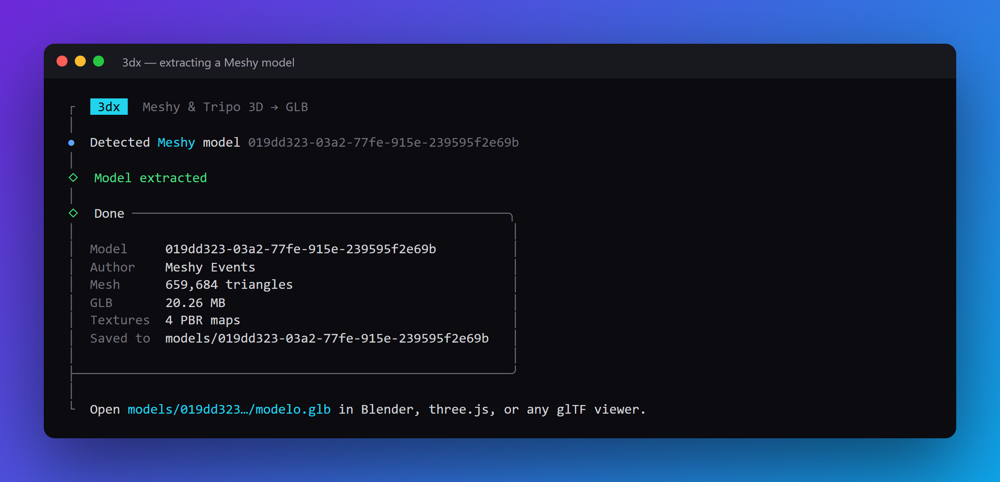
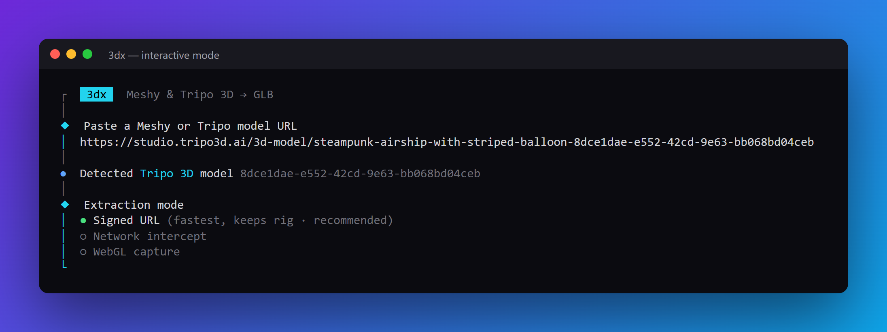

<div align="center">

# 3dx

### Save any public **Meshy** or **Tripo 3D** model as a ready-to-use **GLB**.
One command. Textures, previews and metadata included.

[](https://github.com/Hectorajm2001/3d-extractor/stargazers)
[](LICENSE)
[](https://nodejs.org)
[](#requirements)



**If this saved you time, a ⭐ helps other 3D folks find it.**

</div>

---

## Why 3dx

- **Paste a link, get a GLB.** No accounts, no DevTools, no copy-pasting signed URLs.
- **Auto-detects** Meshy or Tripo from the URL.
- **Everything in one folder:** `modelo.glb`, PBR textures, preview images, input image and a `metadata.json` (name, author, prompt, hashes).
- **Pretty and friendly:** interactive prompts, live progress, clear errors.
- **Works with Brave, Chrome or Edge** that you already have installed. Nothing big to download.

## Quick start

```bash
git clone https://github.com/Hectorajm2001/3d-extractor.git
cd 3d-extractor
npm install
```

Run it with no arguments for the interactive flow:

```bash
npm start
```

<div align="center">

</div>

Or pass a link directly:

```bash
npm start -- "https://www.meshy.ai/3d-models/019dd323-03a2-77fe-915e-239595f2e69b"
npm start -- "https://studio.tripo3d.ai/3d-model/steampunk-airship-with-striped-balloon-wooden-hull-and-metallic-brace-8dce1dae-e552-42cd-9e63-bb068bd04ceb"
```

Want a global `3dx` command? Run `npm link` once, then just `3dx <url>`.

## Options

| Flag | What it does |
|---|---|
| `-o, --out <dir>` | Output folder (default `./models`) |
| `-m, --mode <mode>` | Tripo only: `payload` (default), `network`, or `gpu` |
| `--no-textures` | Skip PBR texture maps |
| `--no-preview` | Skip preview images |
| `--show-browser` | Show the browser window (helps if headless fails) |
| `--browser <path>` | Point to a specific Brave / Chrome / Edge |
| `3dx verify <file.glb>` | Inspect a GLB: triangles, skins, animations, materials, textures |

## What you get

```
models/<id>/
├── modelo.glb        the model
├── metadata.json     name, author, prompt, SHA-256, signature expiry
├── preview.webp      official preview
├── texturas/         PBR maps (color, normal, roughness, metallic)
└── animaciones/      Tripo retargeting clips (optional)
```

Open the GLB in Blender, three.js, Godot, Unity, or [gltf-viewer.donmccurdy.com](https://gltf-viewer.donmccurdy.com).

## Tripo modes

| Mode | Best for | Keeps rig? |
|---|---|---|
| `payload` (default) | Fast, full quality | Yes |
| `network` | When the payload has no URL; grabs what the viewer downloads | Yes |
| `gpu` | Last resort; rebuilds the mesh from WebGL | No (static) |

## Requirements

- Node.js 20+
- Brave, Chrome or Edge (auto-detected on Windows, macOS and Linux)
- Internet connection

## How it works

- **Meshy** serves a proprietary `.meshy` container that its viewer decrypts in the browser. 3dx runs that same worker inside `meshy.ai` and streams the resulting GLB to disk.
- **Tripo** server-renders the page and exposes a signed GLB URL in its Nuxt payload. 3dx reads it; if missing, it can intercept the viewer's download or capture WebGL buffers with [WebGLRipper](https://github.com/int3re/WebGLRipper) (MIT).

Each engine also works standalone, see [`meshy-extractor`](meshy-extractor/) and [`tripo-extractor`](tripo-extractor/) (their READMEs are in Spanish).

## Responsible use

Use 3dx only on models you own or have explicit permission to use. It retrieves assets the viewers already send to your browser; it does not make a private model free or replace a license. Respect Meshy's and Tripo's terms and the creators' copyright.

## Contributing

Issues and PRs are welcome: new platforms, fixes when a site changes, translations. Keep PRs small and say which URL you tested.

## Star history

[](https://star-history.com/#Hectorajm2001/3d-extractor&Date)

## License

MIT, see [`LICENSE`](LICENSE). Tripo's `gpu` mode bundles WebGLRipper under its own MIT license in `tripo-extractor/vendor/`.
